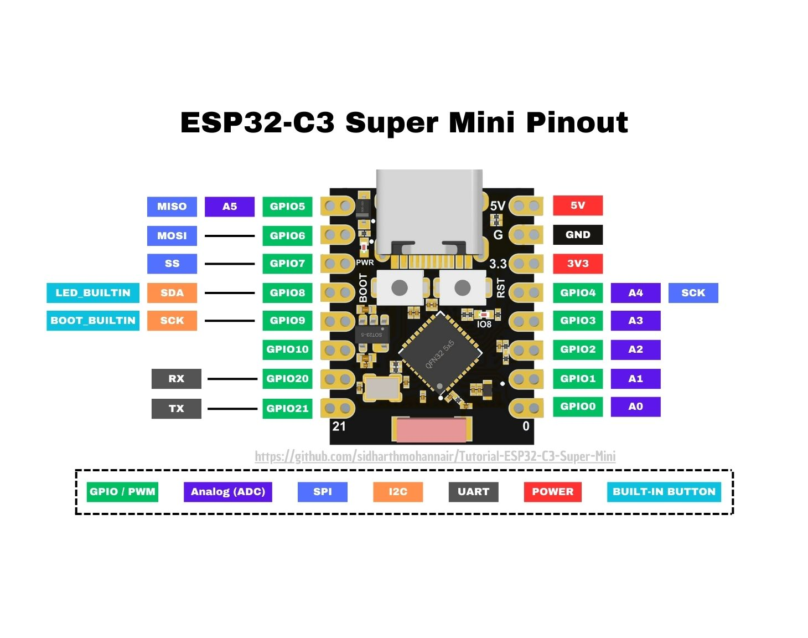

# BLEuno (ble led controller)

## 프로젝트 구성

- 이 저장소는 BLEuno 펌웨어와 [하드웨어](hardware/README.md)를 관리합니다.
- [BLEuno type_m / v1](hardware/type_m/v1/README.md)은 지정 EasyEDA 마더보드를 KiCad로 이전한 하드웨어입니다. 모델명은 `type_m`, 하드웨어 리비전은 `v1`이며, 프로젝트명은 `type_m_v1`입니다. 펌웨어 버전 `1.0.5_dev`와 별도로 관리합니다.
- [BLEuno type_m / v1.1](hardware/type_m/v1.1/README.md)은 원본 v1을 보존하고 SEN1–GPIO20 배선을 추가한 뒤, 2026-11-01 전원부 수정으로 배터리 커넥터 극성 표시·이름(`BAT`)과 전원 스위치 J2의 직렬 연결(배터리 + → VIN → J2 → VCC)을 바로잡은 수정본입니다. [KiCad 프로젝트](hardware/type_m/v1.1/kicad/type_m_v1_1.kicad_pro)의 DRC 오류·미배선·회로도/PCB 차이는 0, ERC는 오류 20·경고 26이며, 제작·실물 검증은 완료하지 않았습니다. 수정 전후 그림은 [전원부 수정 확인 화면](hardware/type_m/v1.1/validation/power-fix-2026-11-01/review.html)에 있습니다.
- [BLEuno type_s / v1](hardware/type_s/v1/README.md)은 `ZeroFactorySensorBoard / Board_DHT` 원본의 센서·입출력 커넥터 보드입니다. [원본 핀맵](hardware/type_s/v1/pinmap.md)에 연결과 저항값 확인 사항을 기록했습니다. 센서 실장·펌웨어 지원·실물 동작 검증을 뜻하지 않습니다.
- **두 보드의 수업 배치는 보류하고 type_m 보드 완성을 우선합니다.** 센서는 DHT11·DHT22를 선택했고 GPIO20 지원을 추가합니다. [교재의 SmartIO 및 bleuno 공통 코드](https://github.com/gbox3d/teaching_repo/tree/main/android_programming/bleuno)는 기존 자료로 유지합니다.
- 현재 type_s 전용 펌웨어는 없으며, 기존 LED 4핀 설정 `ledpin=[4,3,1,0]`은 type_s의 센서·배터리 분압 입력과 충돌합니다. 기존 수업 설정을 두 보드에 바로 적용하지 않습니다.
- type_m 펌웨어와 독립 앱 `TypeMControl`의 구현·BLE 실기 검증 범위는 아래 기록을 따릅니다. 센서 배선 연속성·실제 온습도 측정과 모터·서보 부하 검증은 남아 있습니다.
- [bleunoApp/BleunoTest](https://github.com/gbox3d/bleunoApp/tree/main/BleunoTest)는 보드 점검·강의자 시연용 독립 앱입니다.
- AI 작업 인수인계: [_forAI/README.md](_forAI/README.md).

## type_m 모터·서보·DHT 제어

type_m v1은 **`type_m` 빌드 환경 / `type_m/1` 프로토콜**을 사용합니다. 모터 2개·서보 2개의 `1.0.0` 검증 기록을 보존하며, **`1.1.0`에 DHT11·DHT22 지원을 추가하고 보드에 업로드했습니다.** 독립 앱 `bleunoApp/TypeMControl`의 DHT 화면도 구현했고 단위 테스트 34개·Lint 문제 없음, IM_L101(API34) 설치·연결·종류 선택·오류 표시·정지·배경 전환을 확인했습니다. [빌드·핀맵·명령·정지 동작 가이드](docs/type_m.md)와 [기존 90분 실습 참고 자료](https://github.com/gbox3d/teaching_repo/blob/main/android_programming/bleuno/type_m_lab.md)가 있으며, 수업 적용은 보드 완성 뒤 결정합니다.

센서 포트 **J7은 패드 1=3.3V, 2=SEN1, 3=GND**입니다. 원본 v1은 SEN1–MCU 연결이 누락돼 있습니다. **v1.1 수정본은 J7.2·R3.2·U1 패드15(GPIO20)를 SEN1으로 연결**하고 R3 10kΩ 풀업을 유지합니다. 원본 v1은 보존하며, 설계 파일 수정만으로 이미 실장한 v1의 물리 배선이 바뀌지는 않습니다. J7.2–U1 패드15 점퍼는 기존 v1의 임시 보수 방법일 뿐 정규 사용 절차가 아니며, 현재 작업은 v1.1 설계 수정입니다. 사용자는 DHT22를 SENSOR1에 연결했다고 확인했고 실제 온습도 측정은 아직 성공하지 못했습니다. v1.1 전원부에서는 배터리 +가 스위치 J2를 거쳐 VCC로 가며(1=OFF, 2=COM, 3=ON), 스위치 접점 정격과 USB·배터리 동시 연결 주의는 [v1.1 안내](hardware/type_m/v1.1/README.md#전원-경로와-주의)를 따릅니다. [리비전별 연결·전원 조건](docs/type_m.md#dht11dht22-연결과-조회)을 확인하세요.

1.1.0의 `dht 11`/`dht 22`로 종류를 선택하고 `dht`로 조회합니다. 펌웨어 기본은 DHT11이고 앱은 선택한 종류를 저장하며, 측정 주기는 2500ms입니다. 응답 예시 `dht 22 253 614`는 25.3°C·61.4%RH를 뜻하며 준비 중에는 `wait`, 읽기 실패에는 `error`를 반환합니다. 센서 읽기 실패 자체는 BLE 연결·모터 READY를 해제하지 않습니다. **1.1.0 호스트 501 checks·빌드·COM11 업로드/hash 검증·BLE 비구동 54 checks를 통과했습니다.** 실제 시험에서는 두 종류 모두 `error`였고, 종류 변경 직후 `wait`와 실패 후 READY 유지·STOP·watchdog·재연결을 확인했습니다. 앱에서도 DHT22 선택 유지, STOP·Home 단절 후 내부 출력 0을 확인했습니다. 실제 온습도 수치는 아직 검증하지 않았습니다.

저장소 루트에서 이미 설치된 Python을 `uv`로 재사용합니다. Python을 새로 설치하거나 자동 다운로드하지 않습니다.

```powershell
uv python list --only-installed
uv run --no-python-downloads --python 3.12 --with platformio==6.2.0 python -m platformio run -e type_m
# COMxx는 현재 확인한 보드 포트로 바꿉니다.
uv run --no-python-downloads --python 3.12 --with platformio==6.2.0 python -m platformio run -e type_m --target upload --upload-port COMxx
```

CCCD 알림 구독 → `about`의 모델·버전 확인 → `ready`/`ok ready`를 마쳐야 제어할 수 있습니다. 1.0.0의 응답은 `type_m/1 fw=1.0.0`, DHT 확장 버전은 `type_m/1 fw=1.1.0`입니다. 상태 RGB는 대기 빨강 점멸 → BLE 연결 파랑 점멸 → 준비 완료 파랑 고정입니다. `stop`은 양 모터와 양 서보 펄스를 끄며, 1500ms watchdog과 앱의 500ms heartbeat를 함께 사용합니다.

사용자는 type_m v1을 설계대로 실장했으며, 모듈은 RGB가 있는 EstarDyn ESP32-C3 SuperMini Plus V2.0이라고 확인했습니다. GPIO8 NeoPixel 설정으로 업로드 뒤 대기 빨강 점멸과 준비 완료 파랑 고정을 확인했습니다. 준비 전 파랑 점멸은 소스·상태 기준입니다. GPIO0은 배터리 ADC이므로 LED 시험 출력으로 쓰지 않습니다. 아래 기존 LED/DHT 명령과 `Config` 설정은 type_m에 적용하지 않습니다.

**1.0.0 기준으로** 호스트 **399 checks**, Android 단위 **17개**·Lint, 펌웨어 빌드·업로드, BLE 비구동 검사 **29개**를 통과했습니다. IM_L101(API34)에서 보드 검색·CCCD/about/ready·STOP 응답·배경 진입 후 연결 해제·재연결 준비를 확인했고 내부 출력 상태는 모두 0이었습니다. 업로드한 COM11/MAC 끝자리 `b3:6e`와 최초 COM14/`54:d5`의 4MB 백업은 각각 보존했습니다. 이 결과를 1.1.0 DHT 검증으로 확대하지 않습니다. 0이 아닌 모터 명령·유효한 서보 명령과 실제 파형·부하 시험은 수행하지 않았습니다. [검증 현황과 백업 해시](docs/type_m.md#대상과-현재-확인-범위)를 확인하세요.

## Description
This is a simple BLE LED controller that can be used to control an LED over BLE. The controller is implemented using the ESP32 microcontroller and the Arduino framework. The controller can be used to turn the LED on and off, as well as to change the color of the LED.

devoce name start with `ESP32_BLE'  


## uuid

The UUIDs for the service and characteristic are defined in the `ble_led_controller.ino` file. The UUIDs are as follows:
```cpp
#define SERVICE_UUID "c6f8b088-2af8-4388-8364-ca2a907bdeb8"
#define CHARACTERISTIC_UUID "f6aa83ca-de53-46b4-bdea-28a7cb57942e"
```

```txt
service-uuid : c6f8b088-2af8-4388-8364-ca2a907bdeb8
characteristic-uuid : f6aa83ca-de53-46b4-bdea-28a7cb57942e
```


## Commands

아래 핀 설정은 기존 보드별 사용 예시입니다. `type_m`·`type_s` v1의 확정 설정이 아니므로 [모델별 핀맵](hardware/README.md)을 먼저 확인합니다.

**setup led pins** : Setup the pins for the LED  

```txt
config setA ledpin [4,3,1,0] // espc3 tenstar  -> gpio4,gpio3,gpio1,gpio0
config setA ledpin [3,4,5,7] // espc3 -> d1,d2,d3,d5 
config setA ledpin [3,4,5,6,7,8,9] // espc3 -> d1,d2,d3,d4,d5 ,d8,d9 , (d4,d9) 는 부팅시 사용하므로 사용에 주의
config setA ledpin [1,4,6,5] 
config setA ledpin [4,16,17,18] 
config setA ledpin [2,12,15,4,13,14,16,17,18] 
config setA ledpin [0,2,5,12,15,13,14,18,19] 
config setA ledpin [15,2,0,4,16,17,18,19] //worover kit
config setA ledpin [15,2,0,4] //worover kit
config save
reboot
```

**setup pwm pins** : Setup the pins for the PWM  
```txt
config setA pwmpin [16,17,18,19] //
```


**on** : Turn the LED on   
example:    
`on 1` : turn led index 1 on  
`on 3 6 9` : turn led index 3, 6, 9 on  
`on -1` : all leds on  

**off** : Turn the LED off  
example:  
`off 1` : turn led index 1 off  
`off 3 6 9` : turn led index 3, 6, 9 off 
`off -1` : all leds off  

**pwm** : Set the PWM value for the LED
example:
`pwm -1 255` : set all pwm value to 255
`pwm 0 255` : set the PWM value for led index 1 to 255

dht11 pin setup
```txt

config set dht11pin 7

config set dht11pin 32
config save
reboot
```
**safe back delay** : Set the safe back mode for the LED
example:  
```txt
config set safebackdelay 0
config set safebackdelay 500
config save
```

## board info

### esp32c3 tenstar


**주의 사항**

- 사용해도 되는 핀 : 0, 1, 3, 4, 5, 6, 7, 10   
- 아날로그 입력 핀 (ADC) : 0, 1, 2, 3, 4, 5 (보드에 A0~A5로 표기됨)  
- PWM 핀 : 모든핀 가능  
- i2c 는 가능한 4,5번 핀을 사용하세요.    
- 8 번핀 : 내장 ws2812 용도 neo 픽셀 사용시 8번 핀을 사용합니다.  
- 2,9 번핀 : 부팅시 사용하므로 사용에 주의하세요.   
- 5 번핀은 wifi 사용시 값이 불안정할 수 있습니다.  

```txt
config setA ledpin [4,3,1,0] // espc3 tenstar  -> gpio4,gpio3,gpio1,gpio0
config set dht11pin 7
config save

reboot
```


